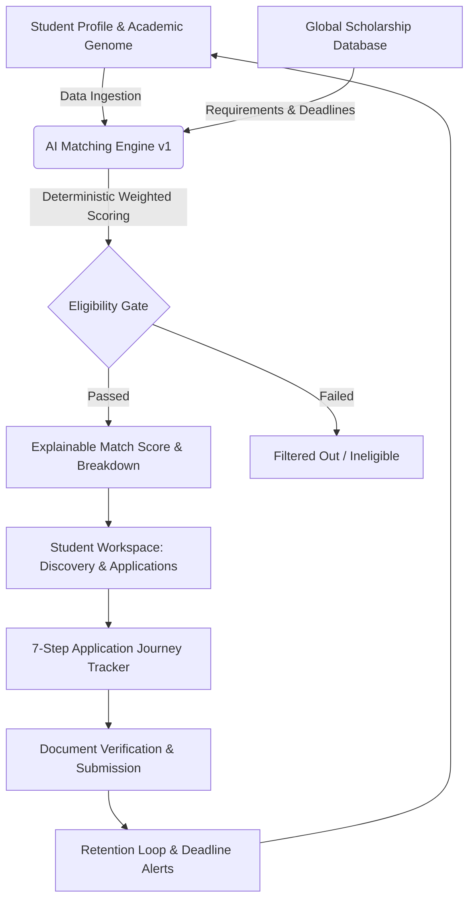
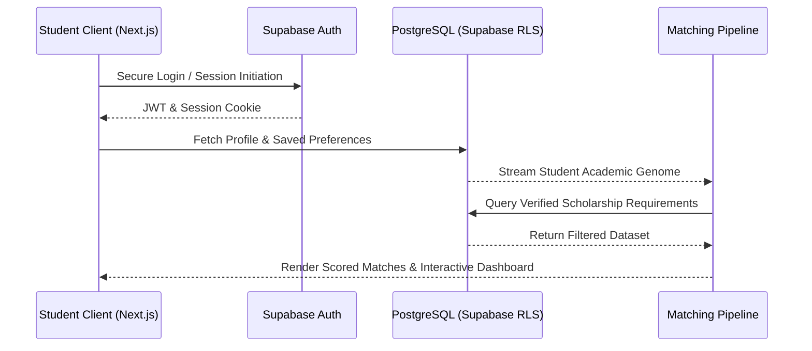

<div align="center">

# 🎓 ScholarMatch — AI-Powered Fully Funded Scholarship Platform

> **"The intelligent scholarship companion built by an AI Engineer — designed to eliminate the chaos of international funding searches and guide students from discovery to application."**

<p align="center">
  <a href="https://www.scholarmatch.me"></a>
  <a href="https://github.com/mudasirrashid/scholarmatch-preview"></a>
  <a href="https://nextjs.org"></a>
  <a href="https://www.typescriptlang.org"></a>
  <a href="https://supabase.com"></a>
  <a href="https://tailwindcss.com"></a>
</p>

</div>

---

## 🎨 1. Executive Vision & The Psychology
> *International students face massive structural friction when searching for international funding. Generic search engines throw thousands of irrelevant results, leading to decision fatigue, confusion, and abandoned academic dreams.*

**ScholarMatch** re-engineers this journey by acting as a hyper-intelligent academic companion. Built by an AI Engineer, it shifts the paradigm from **primitive keyword searching** to **deterministic intelligent matching**, evaluating a student's precise academic genome against global funding requirements.

---

## 🔄 2. The Core Lifecycle Loop
```text
 ┌───────────────┐     ┌───────────────┐     ┌──────────────────┐     ┌────────────────┐
 │  01. PROFILE  │ ──► │   02. MATCH   │ ──► │  03. UNDERSTAND  │ ──► │  04. PREPARE   │
 └───────────────┘     └───────────────┘     └──────────────────┘     └────────────────┘
         ▲                                                                     │
         │                                                                     ▼
 ┌───────────────┐     ┌───────────────┐     ┌──────────────────┐     ┌────────────────┐
 │   07. RETURN  │ ◄── │   06. TRACK   │ ◄── │    05. APPLY     │ ◄── │  DOCUMENTS     │
 └───────────────┘     └───────────────┘     └──────────────────┘     └────────────────┘
```

---

## 🏗️ 3. Dual-Sided Platform Architecture

### 🌐 A. Public Cinematic Discovery Engine (`/`)
* **Immersive Hero Experience:** Dynamic living UI showcasing live match-score visualizations (e.g., Oxford 96% Match live preview cards with interactive bubble/glow micro-interactions).
* **Advanced Taxonomy Filters:** Instant multi-criteria filtering by Degree (Undergraduate, Master's, PhD), Country, Funding Status (Fully Funded vs Partially Funded), Field of Study, and Deadlines.
* **Deep-Dive Resource Hub:** Comprehensive exploration pages structured to minimize cognitive load and maximize opportunity discovery.

### 🔐 B. Student Ecosystem (`/dashboard`)
* **Dedicated Workspaces:** Routing architecture optimized for students across `/dashboard`, `/profile`, `/matches`, `/scholarships/[id]`, `/applications`, `/saved`, `/documents`, `/alerts`, and `/ai-assistant`.
* **Secure Infrastructure:** Powered by Supabase Auth with Row Level Security (RLS) data isolation and automated profile-to-database synchronization triggers.

---

## 🤖 4. The Intelligence Core: Matching Engine v1

ScholarMatch avoids primitive keyword matching by deploying a rigorous multi-dimensional deterministic scoring pipeline combined with explainable metrics:

| Scoring Dimension | Weight | Graphic Indicator & Impact |
| :--- | :---: | :--- |
| **Field of Study** | **25%** | `██████████` Deep semantic overlap of majors & research areas |
| **Degree Level** | **20%** | `██████████` Strict alignment with Bachelor's/Master's/PhD |
| **Academic / GPA** | **20%** | `██████████` Institutional standing vs hard GPA cutoffs |
| **Nationality Gate** | **15%** | `█████████░` Zero-waste filtering blocking ineligible regions |
| **Language Prof.** | **10%** | `████████░░` IELTS/TOEFL or institutional medium validation |
| **Experience** | **5%** | `██████░░░░` Scans work history, research papers, portfolios |
| **Preferences** | **5%** | `██████░░░░` Tailors regional, financial, and lifestyle goals |

> ### 🔍 Explainable AI & Transparency
> Every match outputs clear diagnostic indicators:
> * ✅ **Why you match:** Verified proof of satisfied criteria (e.g., GPA requirement met, country eligible).
> * ⚠️ **One thing to improve:** Actionable feedback (e.g., language requirement verification pending).
> * 🤖 **Ask ScholarMatch (AI Assistant):** Natural language querying (*"I have a 3.4 GPA in Computer Science..."*) instantly filtered and categorized.

---

## 📊 5. System Architecture & Data Flow





---

## 🎯 6. Application Intelligence & Workflow

To eliminate application anxiety, the platform embeds a 7-step interactive milestone tracker:

```text
  [01. Eligibility] ──► [02. Documents] ──► [03. Account] ──► [04. Application]
         ▲                                                            │
         │                                                            ▼
  [07. Submit Portal] ◄── [06. Review] ◄── [05. Upload Docs] ◄────────┘
```

* **Interactive Document Checklists:** Built-in tracking for passports, transcripts, CVs, and motivation/recommendation letters.

---

## 🎨 7. Design System & Aesthetic Engineering
* **Visual Identity:** Premium fintech × modern AI × elite university hybrid.
* **Surface Architecture:** Deep dark interfaces combined with sophisticated glassmorphism, fine borders, soft shadows, and high-whitespace typography.
* **Intentional Motion:** Framer Motion-powered micro-interactions (card hovers, match score counting, progress trackers) designed solely to enhance user feedback and cognitive clarity.

---

## 📸 8. Platform Preview & UI Walkthrough

| AI Discovery & Matching Dashboard | Application Journey Tracker |
| :---: | :---: |
|  |  |

---

## 🛡️ 9. Repository Notice & Academic Integrity
> This repository serves as the public architectural documentation hub for **ScholarMatch**. The core proprietary source code, database migration scripts, and underlying AI scoring microservices remain protected in a private repository for intellectual property security.
